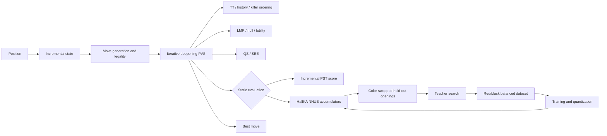
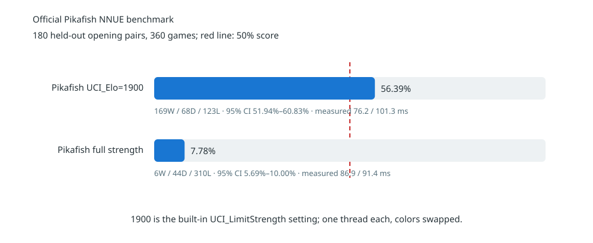
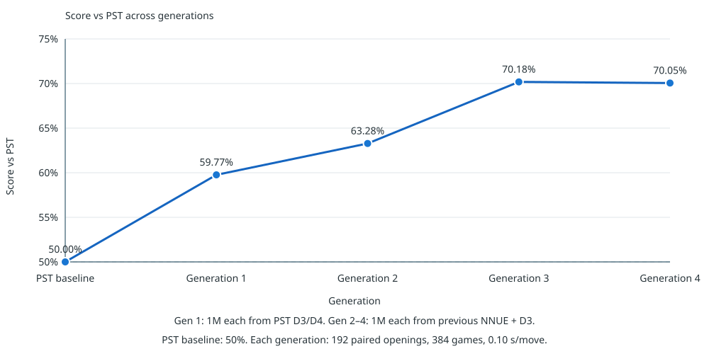
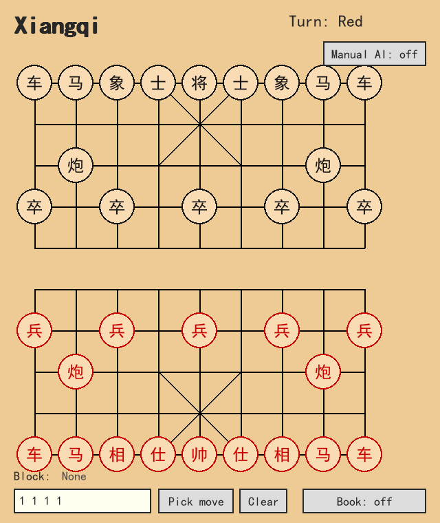
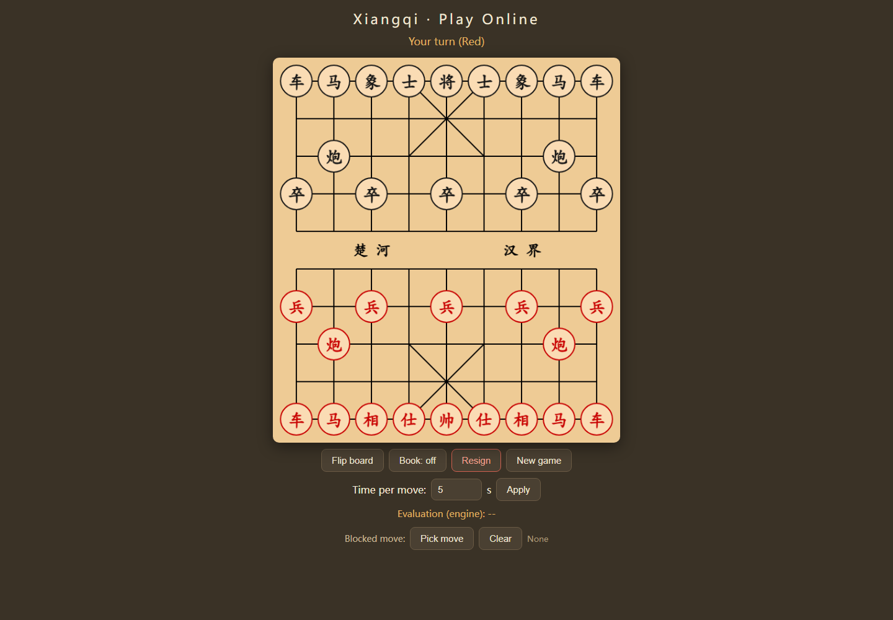

# Xiangqi AI: Incremental Search and Quantized NNUE

[English](README.md) · [简体中文](README_zh.md)

[Play online](http://164.152.167.211:8100/) · [Interactive tutorial](slides-formal-web-lite/index.html) · [Tutorial PDF](slides-formal-web-lite/xiangqi-engine-tutorial.pdf) · [Running the project](docs/RUNNING.md) · [Experiments](docs/EXPERIMENTS.md) · [NNUE details](trainnnue/README.md)

## Overview

A Chinese chess engine built from scratch for ordinary CPUs, combining reversible incremental state, PVS search, and a quantized HalfKA NNUE.

**2026-11-06 update:** the deployed model is **g006 H128, int8 feature weights / int16 accumulators, E20 QAT**, trained from the project’s own pure-PST restart chain. The chain completed 28 historical comparisons (5,376 games), promoted g006, and stopped after g007 failed two historical point-score gates.

| Opponent | W / D / L | Score (95% CI) | Actual ms (ours / opponent) | Reference Elo (95% CI) |
|---|---:|---:|---:|---:|
| ElephantEye 3.1 (new) | 142 / 35 / 15 | 83.07% (78.91%–87.24%) | 149.089 / 148.672 | 2407 (2359–2464) |
| Tianqi V1.1.8 (new) | 126 / 42 / 24 | 76.56% (71.61%–81.51%) | 150.358 / 152.969 | 2636 (2591–2688) |
| Cyclone 2007C (reused observation) | 78 / 63 / 51 | 57.03% (52.08%–61.98%) | 144.366 / 142.902 | 2649 (2614–2685) |

The fixed three-anchor fit is **2601 reference Elo** (opening-pair bootstrap 95% CI 2574–2629). The point estimate is just above 2600, with its interval spanning 2600. The opponent-specific ratings range from about 2407 to 2649, so this is an approximately 2600 coordinate on the cited historical engine scale. The Cyclone 2600 anchor refers to top professional and grandmaster play in 2006–2007.

Both new matches passed independent 48-pair timing confirmation before 96 formal opening pairs. Each side's actual mean must be within 150ms ±5%, with time-ratio deviation at most 5%. Nominal budgets were frozen before formal play and were selected using timing only. Cyclone reuses the existing g006 observation, accepted under its original relative-only timing gate. The new matches use production engine `ad9a1567…99d5db`; Cyclone used experimental engine `e6f367…`. The model is identical, but this is not one newly run three-opponent production-engine tournament. Full identities and pure-win intervals are in the compact JSON and recipe.

[Current report](docs/nnue_g006_20261106/REPORT.md) · [Frozen recipe](docs/nnue_g006_20261106/recipe.json) · [Compact games](docs/nnue_g006_20261106/matches.compact.json).

Model SHA-256: `746e930533cddf7907c85545659605b7477bf32bdb0335a6ca0b3b743455af5e`. [Play online](http://164.152.167.211:8100/).

## 1. Questions and implementation

1. How can board state and derived values be updated and restored accurately and cheaply across millions of trial moves?
2. How can ordering, caching, and selective search produce deeper useful analysis within a fixed time budget?
3. How can neural evaluation balance expressive power and inference cost to improve equal-time strength?

| Component | Implementation | Purpose |
|---|---|---|
| Incremental state | Board, piece lists, kings, occupancy, PST, hash, NNUE accumulators | Reduce move and evaluation cost |
| Search | Iterative deepening, PVS, TT, QS/SEE, ordering, LMR, null move, futility | Search useful lines more deeply |
| Evaluation | PST baseline and quantized HalfKA NNUE | Measure gains from neural evaluation |
| Experiments | Balanced data, configurable teachers, early stopping, paired statistics, generated figures | Trace conclusions to data, models, and games |
| Integration | stdio, pygame, FastAPI/WebSocket, Pikafish bridge | Share one search core across clients and experiments |

## 2. System design



Teacher search labels positions; trained models are quantized for C++ inference; models selected through equal-time matches become teachers for subsequent data generation. Search, training, and matches form a reproducible cycle.

## 3. Incremental state and rules

Positions use `board[10][9] + turn`, with uppercase pieces for Red and lowercase pieces for Black. Seven piece types generate pseudo-legal moves, filtered by making each move, checking king safety, and undoing it.

Each move updates the board and piece lists, king coordinates, row/column occupancy and attack state, material/PST scores, Zobrist hash and repetition history, and both NNUE accumulators. Captures keep piece lists contiguous through swap removal. Undo restores every derived value, allowing sibling branches to reuse one state object. Both browser and server validate human moves.

## 4. Static evaluation

### Material and piece-square tables

PST evaluation adds material value and a square bonus, positive for Red and negative for Black. `current_score` is updated by removing the source contribution, adding the destination contribution, and removing any captured piece. `evaluate()` returns the cached score in constant time.

PST also serves as the residual baseline for NNUE. Both evaluation paths share position, move, and search code, concentrating comparisons on evaluation.

### NNUE architecture

```text
HalfKA (7,560 independent rows, expanded to 11,340) → H128 → CReLU → phase output → PST residual
```

Features index 9 friendly-king positions × 14 relative-side/piece channels × 90 squares. Three pairs of side king buckets share simultaneously mirrored piece-square vectors; the three central buckets remain independent. Two oriented perspectives share the feature table. Export expands shared weights, so inference adds no mirror lookup. The deployed model uses int8 feature weights, int16 accumulators and E20 QAT. Model and native inference details are in the [current report](docs/nnue_g006_20261106/REPORT.md).

### Incremental accumulators

The first layer is cached in two perspective accumulators. Ordinary moves subtract the source feature and add the destination feature; captures also subtract the captured piece. King moves rebuild the affected anchored perspective. `undo_move()` reverses updates exactly; null moves change only the side to move. Updating changed features makes NNUE practical in the high-frequency quiescence path.

### Training and teacher iteration

The pure-PST restart chain uses Top-3 exploration (50% / 30% / 20%), with labels always taken from an independent single-PV best search. PST plays and labels at D4; later NNUE generations use D3. Each historical source contributes two million fresh valid positions per generation, giving 2M through 14M datasets. H128 is randomly initialized each generation, trained only on normalized clipped search-residual MSE, then fine-tuned by fixed-scale QAT. Whole-game splits are 98% / 1% / 1%. External engines supply evaluation only. The saved label `S_i` is the sample’s independent single-PV best score with its actual pre-root history; the network input `B_i` is board plus side to move. See the [formula and recipe](docs/nnue_g006_20261106/REPORT.md).

## 5. Search

Minimax maximizes for Red and minimizes for Black, evaluating leaf positions statically. Timed iterative deepening increases depth while retaining the best move and score from the latest completed iteration.

| Mechanism | Information | Benefit |
|---|---|---|
| Alpha-beta / PVS | Current score window | Cut branches that cannot affect the parent choice |
| Aspiration window | Narrow window around the previous score | Improve cutoff efficiency in stable positions |
| Zobrist hash / TT | Depth, score, bound type, best move | Reuse transpositions and prioritize promising moves |
| Quiescence search | Captures, checks, forcing continuations | Reach more stable leaf positions |
| SEE | Static gain from exchanges on a square | Improve capture ordering and quiescence efficiency |

TT scores include the chosen leaf evaluator and are reused according to saved depth and bound type. Principal variations and TT moves improve ordering for the next iteration.

## 6. Selective search and time management

| Category | Methods | Basis |
|---|---|---|
| Ordering | TT move, MVV-LVA, killer, counter move, history | Previous searches and tactical value |
| Reduction | LMR, LMP | Late move order, depth, quietness |
| Forward pruning | Null move, futility, reverse futility, razoring | Static score relative to the search window |
| Recovery | Re-search after failed narrow windows; full depth for critical moves | Results crossing current bounds |

Deadline checks occur in the node loop; completed results are committed at iteration boundaries. The teacher shares rules, evaluation, and quiescence but disables heuristic forward pruning to produce fixed-depth labels.

## 7. Experimental design

Current mainline comparisons use 96 color-swapped opening pairs (192 games) per historical opponent. Independent calibration freezes nominal budgets before formal play; each side’s actual mean must lie within 150 ms ±5%, and the deviation of their actual-time ratio from 1 must be at most 5%. Promotion requires every historical point score `(wins + draws/2)/games` to exceed 50%; all scheduled comparisons finish before stopping. Pure win rates, paired 95% intervals and measured times are reported separately in the [current report](docs/nnue_g006_20261106/REPORT.md).

The older 360/384-game protocols and figures below belong to the historical Iter2 experiments.

## 8. Historical results (Iter2 and earlier)

The historical Iter2 **363 KB** model uses **XQ-HalfKA-9x14x90 → H16 → CReLU → phase-specific output heads**. It scored **70.18%** against the project's PST baseline in internal equal-time matches. Results against three historical engines imply **2369–2452 Elo**, placing it around **2400 Elo**, with **human-master level as an approximate rating reference** ([official human ratings](https://www.sport.gov.cn/qpzx/n5384/c23886046/content.html); details below).

| Opponent | Our wins / draws / losses (score rate) | Implied Elo |
|---|---:|---:|
| [ElephantEye 3.1](trainnnue/iter2_vs_eleeye31_180pairs.json) | 290 / 31 / 39 (84.86%) | ≈2430 |
| [Tianqi V1.1.8](trainnnue/iter2_vs_tianqi118_180pairs.compact.json) | 109 / 79 / 172 (41.25%) | ≈2369 |
| [Cyclone 2007C](trainnnue/iter2_vs_cyclone2007c_180pairs.compact.json) | 60 / 95 / 205 (29.86%) | ≈2452 |
| [Pikafish 2026-01-31 · UCI_Elo=1900](trainnnue/iter2_vs_pikafish_elo1900_180pairs.json) | 169 / 68 / 123 (56.39%) | ≈1945 (limited-strength scale) |
| [Pikafish 2026-01-31 · full strength](trainnnue/iter2_vs_pikafish_official_180pairs.json) | 6 / 44 / 310 (7.78%) | ≈3573 (cross-generation comparison) |

Reference ratings come from a [public Xiangqi engine rating list](https://zhuanlan.zhihu.com/p/2072972857840350627). The conversion is `opponent reference Elo + 400 × log10(score / (1 − score))`, with reference ratings 2130.4, 2430, 2600, and 4002.7 for ElephantEye, Tianqi, Cyclone, and full-strength Pikafish. Pikafish 1900 uses its built-in strength-limiting scale. See the [results report](trainnnue/RESULTS.generated.md) for game records, measured times, executable hashes, and reproduction commands.

The human-master reference comes from the Chinese Xiangqi Association's [slow-play rating announcement as of December 31, 2021](https://www.sport.gov.cn/qpzx/n5384/c23886046/content.html), published by the Board and Card Games Administrative Center of the General Administration of Sport of China. Its [rating attachment](https://www.sport.gov.cn/qpzx/n5384/c23886046/part/23887091.doc) lists male masters (title column “大”) near 2400, including Wu Wei at **2408**, Li Bingxian at **2406**, Yu Bing at **2397**, and Liu Junda at **2396**. These entries provide historical context for the numerical comparison; the engine estimate comes from engine matches, and equivalence to human playing strength would require calibration through human–engine games under matched time controls.


### External matches



The historical table in this section reports the external Iter2 results. Each match uses 180 color-swapped opening pairs (360 games) with fixed CPU affinity. Mean measured times (our engine / opponent) are 104.0 / 119.4 ms for ElephantEye, 155.0 / 159.6 ms for Tianqi, 112.4 / 89.9 ms for Cyclone, 76.2 / 101.3 ms for limited Pikafish, and 86.9 / 91.4 ms for full-strength Pikafish. Our engine used about 25% more time against Cyclone; the table retains that original condition.

### Model generations



| Generation | Teacher and data | Score vs PST | Wins / draws / losses |
|---:|---|---:|---:|
| PST baseline | PST | 50.00% | Reference |
| 1 | PST D3 and D4, one million positions each | 59.77% | 172 / 115 / 97 |
| 2 | Previous NNUE + D3, one million positions | 63.28% | 188 / 110 / 86 |
| **3** | **Previous NNUE + D3, one million positions** | **70.18%** | **218 / 103 / 63** |
| 4 | Previous NNUE + D3, one million positions | 70.05% | 224 / 90 / 70 |

Generation 3 (`Iter2-NNUE-D3`) has the highest observed score, with paired 95% CI **66.80%–73.44%**, and was selected for the web and local NNUE entry points in that historical experiment. Generation 4 reaches the same performance plateau, ending this iteration experiment.

### Width and search cost

D4-H16 scored **54.17%** against D4-H8, with mean completed depths of **9.18 vs 9.24**. H16 adds little depth cost while improving direct-match performance, so it was the selected width in that historical experiment. Offline metrics, curves, Swiss standings, matches, and checkpoints are in the [NNUE guide](trainnnue/README.md) and [generated report](trainnnue/RESULTS.generated.md).

## 9. Reproduction

See [docs/RUNNING.md](docs/RUNNING.md) for environments, compilation, model versions, and configuration.

```powershell
python -m pip install -r requirements.txt
python webapp.py
# Open http://localhost:8000
```

Desktop client:

```powershell
python gui.py
```

| Task | Command / script | Output |
|---|---|---|
| A/B regression | `python ab_selfplay.py baseline.exe candidate.exe` | Logs by time control and summary JSON |
| Official Pikafish | `trainnnue/run_external_match.ps1` | Paired games, measured times, CI |
| ElephantEye 3.1 | `trainnnue/run_eleeye_match.ps1` | UCCI bridge and single-core paired games |
| Cyclone 2007C | `trainnnue/run_cyclone_match.ps1` | Cyclone UCI bridge and legality audits |
| Tianqi V1.1.8 | `trainnnue/run_tianqi_match.ps1` | UCI bridge and legality audits |
| NNUE matches | `python trainnnue/engine_match.py ...` | Game JSON, score rates, paired CI |
| Swiss tournament | `python trainnnue/swiss_tournament.py` | Standings and pairings |
| Teacher iteration | `trainnnue/run_teacher_iteration.ps1` | Data, models, validation, matches |
| Rebuild reports | `python trainnnue/report_results.py` | Markdown tables and SVG plots |
| Tests | `python -m pytest tests -q` | Rules and WebSocket checks |

Saved JSON regenerates the results and figures from one source. See [experiment design](docs/EXPERIMENTS.md) and the [A/B guide](AB_SELFPLAY.md) for protocols.

## 10. Interfaces

A compact stdio protocol connects the search core to clients and batch experiments. FastAPI/WebSocket manages independent games and offers the project's NNUE and PST engines plus Pikafish PST. `pikafish_bridge.py` translates UCI. [`deploy/deploy.ps1`](deploy/deploy.ps1) handles synchronization, compilation, model upload, service restart, and HTTP checks.

| Desktop board | Web application |
|:---:|:---:|
|  |  |

## 11. Repository layout

| Path | Contents |
|---|---|
| [`xiangqi_ai.cpp`](xiangqi_ai.cpp) | PST evaluation, incremental state, main searcher |
| [`trainnnue/`](trainnnue/) | Data generation, training, quantization, validation, matches, models |
| [`common.py`](common.py) | Shared rules, cloud opening book, engine communication |
| [`gui.py`](gui.py) | pygame desktop interface |
| [`webapp.py`](webapp.py), [`static/`](static/) | FastAPI/WebSocket web interface |
| [`tests/`](tests/) | Rules, cloud book, sessions, web tests |
| [`deploy/`](deploy/) | Linux service configuration and deployment |
| [`slides-formal-web-lite/`](slides-formal-web-lite/) | Interactive tutorial and downloadable PDF |
