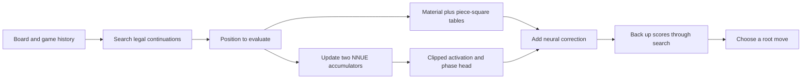

# Chinese Chess: Search and a Self-Trained NNUE

[简体中文](README_zh.md) · [Play online](http://164.152.167.211:8100) · [NNUE implementation](trainnnue/README.md) · [Evaluation report](docs/nnue_g006_20261106/REPORT.md)

This project builds a Chinese chess engine that learns its position evaluation from its own search. The deployed model, **g006**, combines a piece-square evaluation with a 128-dimensional efficiently updatable neural network, or NNUE. It was trained on **12 million self-generated positions**, then quantized and fine-tuned for CPU inference with int8 feature weights and int16 accumulators. External engines are used to measure playing strength; training labels come from the project's own engines.

At approximately 150 ms of actual search time per move, g006 scored **83.07% against ElephantEye 3.1, 76.56% against Tianqi 1.1.8, and 57.03% against Cyclone 2007C**. A joint fit to their historical reference ratings gives about **2601 Elo**, with a 95% opening-pair bootstrap interval of **2574–2629**. The conditions and interpretation of this reference rating appear below.

## How the engine chooses a move

Search explores legal continuations and uses a position evaluator to compare their outcomes. The evaluator must be called repeatedly within a short CPU budget. A piece-square table, or PST, supplies a cheap material-and-position baseline. NNUE learns a correction to that baseline from deeper evaluations produced by the engine's own search.



Training builds the evaluator used in this loop. It generates games, labels sampled positions with the current teacher's best search score, and fits a new network. A candidate becomes the next teacher only after passing scheduled matches against every existing internal opponent.

## From a board to a score

Let $B$ denote the board and side to move, $s$ the side to move, and $o$ its opponent. Scores in the following formulas favor $s$ when positive. The native search stores scores from Red's perspective; multiplying by $\sigma=+1$ for Red to move or $-1$ for Black converts between these conventions.

The baseline $P_s(B)$ sums material values and piece-square bonuses for both armies. NNUE predicts a residual $r(B)$, and the deployed evaluation is

$$
V_s(B)=\operatorname{clip}\bigl(P_s(B)+r(B),-19999,19999\bigr),
\qquad r(B)\in[-300,300].
$$

The residual therefore adjusts an existing material-and-position score. For example, a baseline of $+100$ and a neural correction of $-30$ produce $+70$. These are illustrative numbers; positive still means favorable to the player to move.

### Sparse features and two views of the board

Each active feature identifies four things: the viewing side's king square, a piece type, whether the piece is friendly or hostile, and the piece's square. This representation is often called **HalfKA**. Both kings are included among the pieces. There are nine king squares, seven piece types, two relative sides and 90 board squares:

$$
9\times7\times2\times90=11340
$$

possible feature rows. Every row is a 128-dimensional vector. A view activates one row per piece, so at most 32 vectors contribute to its accumulator. Black's view rotates coordinates by 180 degrees; both views then use the same feature table and bias:

$$
a_v(B)=b+\sum_{f\in F_v(B)}W_f,\qquad v\in\{\text{Red},\text{Black}\}.
$$

Here $F_v(B)$ is the active feature set for view $v$, and $a_v$ and $b$ each have 128 entries. These are two views computed by one shared network.

Training also ties the three pairs of left/right king locations. A feature under a right-hand king shares its vector with the corresponding left-hand king feature **after the piece square is mirrored too**. The three center-file king locations retain separate vectors for all 90 piece squares. This leaves 7,560 independent vectors. Export copies the tied values into the full 11,340-row table, so inference uses ordinary direct indexing.

### Activation and output

The accumulators are clipped element by element to $[0,1]$, then concatenated with the player-to-move view first:

$$
h(B)=\bigl[\operatorname{clip}(a_s,0,1);\operatorname{clip}(a_o,0,1)\bigr]
\in\mathbb{R}^{256}.
$$

This clipped ReLU, or CReLU, is the network's nonlinearity. A linear head maps the 256 entries to one number:

$$
z(B)=v_p^{\mathsf T}h(B)+c_p,\qquad r_{\rm float}(B)=Kz(B),
\quad K=65.38910923790853.
$$

The phase index $p$ selects one of two heads: one for more than 20 pieces and one for 20 or fewer. Its weights are $v_p\in\mathbb R^{256}$ and its scalar bias is $c_p$. Production inference computes only the selected head. The structure is therefore sparse vector addition, CReLU, and a scalar linear output. $K$ expresses the normalized training output in engine score units.

## Making repeated evaluations cheap

A normal move changes only a few active features. With the viewing king unchanged, moving a piece from $x$ to $y$ gives

$$
a'_v=a_v-W_{v,x}+W_{v,y}-W_{v,\mathrm{captured}}.
$$

The final term is omitted for a non-capture. Each term refers to the full feature row, including its piece type, relative side and viewing king. Thus, a rook capture updates a few vectors instead of summing every piece again.

Updates are **lazy**. Making a move records its changes in a search frame. Vector arithmetic occurs when evaluation needs that frame. The engine finds an already computed ancestor and applies the intervening changes; the first update fuses copying the ancestor with subtracting and adding feature rows. A branch cut off before evaluation avoids this work. Undo restores the board and returns to the parent frame, whose accumulator remains available.

Moving the viewing king changes the bucket of every feature in that view. The engine refreshes it using a cache for each of the nine king locations, with a 90-square board snapshot and accumulator per entry. It compares that snapshot with the current board and updates changed squares. The opposite view can still treat the king move as an ordinary piece move.

### Integer inference and QAT

The deployed feature scale is $E=20$: a feature weight $w$ becomes $\operatorname{round}(20w)$, and integer activation clips to $[0,20]$. Feature rows use int8; their sums use int16. Output weights use int16 with output scale $O=128$; a verified int32 dot-product path and an int64 bias addition produce the final integer score.

Scale $E$ is selected after floating-point training as the largest safe integer for that model. Safety covers feature range, bias, and intermediate cache updates. g006 then holds $E=20$ fixed during **quantization-aware training (QAT)**: the forward pass simulates deployment rounding and clipping, while gradients update floating-point parameters. This lets fine-tuning respond to the errors introduced by integer arithmetic. The [NNUE report](trainnnue/README.md) gives the complete integer equations and overflow bounds.

## Training from the engine's own search

The training chain starts with pure PST. Each new generation uses the current selected model as its teacher and plays it against PST and every selected NNUE, including itself. Both colors are used. Every opponent source contributes **two million newly generated valid positions**; previous datasets are kept as records but are not mixed into the new generation.

For g006, g005 supplied all labels while playing against PST and g001 through g005. These six sources produced 12 million positions. The opponent determines the encountered trajectory; the teacher supplies labels on both players' turns.

### Exploration and labels have different jobs

Each game starts with six uniformly random legal plies, which are excluded from sampling. Subsequent moves select rank 1, 2 or 3 with probabilities **50%, 30% and 20%**. With only two legal moves, probabilities become 62.5% and 37.5%; one legal move is taken directly. A ply is one player's move. Games stop after at most 120 plies, and positions are sampled every two plies with sampling phase and colors alternated.

The selected rank is drawn before searching. The teacher first runs an independent full-window, single-principal-variation search and saves its best score. On an opponent turn, the opponent separately searches for its own move. To obtain rank 2, search excludes the first root move; rank 3 excludes the first two. Only the requested ranks are computed. The extra exploration searches preserve the already saved label and restore relevant search-ordering state afterward. No score-gap filter restricts the selected move.

PST uses depth 4; NNUE players and teachers use depth 3. Exploring a lower-ranked move changes which positions the game visits, while the current position's label continues to describe the teacher's best continuation.

### The supervised target

For sample $i$, convert both the saved best search score $S_i$ and PST score $P_i$ to the player-to-move perspective. The residual target and loss are

$$
d_i=\operatorname{clip}(S_i-P_i,-250,250),\qquad
L=\frac1N\sum_i\left(\frac{r_i-d_i}{K}\right)^2.
$$

Here $N$ is the batch size and $r_i$ the predicted residual. For an illustrative $S_i=180$ and $P_i=100$, the network learns an $+80$ correction. This is search distillation through a pure residual mean-squared error. Final game outcomes do not enter the loss. The target limit is 250; deployment permits residuals up to 300.

Teacher search receives the preceding game history, whereas network features contain only board and side to move. Consequently, the network may receive different target contexts for the same input. Dataset construction removes duplicate positions and handles conflicting labels as described in the [training details](trainnnue/README.md#data-construction).

Positions in check and mate/saturated labels are filtered out. Complete games determine the 98% training, 1% validation and 1% held-out calibration split; source and side-to-move quotas are then enforced. g006 has 11,760,000 training positions and 120,000 in each held-out split. Training reshuffles globally each epoch and applies horizontal mirroring with 50% probability.

Each generation starts from random parameters. Floating training is followed by safe-scale selection and fixed-scale QAT. Validation residual MSE selects checkpoints. The resulting candidate must score strictly above 50% against **every** existing internal opponent in 192-game matches before becoming the next teacher. A failed matchup stops expansion after all scheduled opponents have been evaluated.

```text
teacher = PST
opponents = [PST]
repeat:
    data = 2 million fresh valid positions per opponent
           from teacher-versus-opponent games, all labeled by teacher
    candidate = randomly initialize; fit residual MSE
    E = largest safe feature scale
    candidate = QAT fine-tune with E fixed; export integer model
    play 192 games against each opponent at calibrated actual time
    stop unless every matchup scores above 50%
    teacher = candidate
    append candidate to opponents
```

## How search uses the evaluator

Search converts evaluations to Red's perspective: Red chooses the largest returned value and Black the smallest. Backing these choices up through the tree gives each root move a score under the opponent's best searched reply. Iterative deepening completes progressively deeper searches. Principal Variation Search uses a narrow window to test later moves cheaply and searches again when a move needs a more precise bound. A transposition table reuses previously searched positions. At the nominal horizon, quiescence search continues tactical exchanges and check evasions before accepting a static score.

Production search also uses selective reductions and pruning to allocate effort. The dedicated teacher configuration disables transposition-table score cutoffs, null-move pruning, late-move reductions and pruning, futility pruning, razoring, reverse futility pruning, and static-exchange-evaluation filtering. It retains Principal Variation Search, check extensions, quiescence search and repetition rules. Labels are collected at fixed teacher depths; production searches deepen within their time budget.

After completing a depth of at least four, the engine stops starting another iteration when elapsed time exceeds 16% of its nominal budget. Recursive search also checks the hard time limit; an interrupted iteration returns the last completed result. Since different engines use nominal budgets differently, matches calibrate budgets against measured search time before freezing them for formal play.

## Playing strength and fit

Each match below uses 96 color-swapped opening pairs, or 192 games. Score rate is $(W+D/2)/N$; pure win rate is $W/N$. Intervals resample whole opening pairs to keep the two colors together.

| Opponent | Wins / draws / losses | Pure win rate | Score rate (95% interval) | Actual ms/move, g006 / opponent |
|---|---:|---:|---:|---:|
| PST | 163 / 22 / 7 | 84.90% | 90.63% (87.50–93.49%) | 149.359 / 150.835 |
| ElephantEye 3.1 | 142 / 35 / 15 | 73.96% | 83.07% (78.91–87.24%) | 149.089 / 148.672 |
| Tianqi 1.1.8 | 126 / 42 / 24 | 65.63% | 76.56% (71.61–81.51%) | 150.358 / 152.969 |
| Cyclone 2007C | 78 / 63 / 51 | 40.63% | 57.03% (52.08–61.98%) | 144.366 / 142.902 |

The ElephantEye and Tianqi matches used the production engine and passed independent timing confirmation. Formal means had to stay within 150 ms ±5% on each side, with their time ratio within 5% of equality. Internal matches used the same timing requirements with an experimental engine build. The Cyclone observation also used that experimental build, with its original relative-time acceptance rule. All used the same g006 model. The [report](docs/nnue_g006_20261106/REPORT.md) records these conditions and the compact pair evidence.

g006 scored 90.63%, 81.25%, 67.19%, 58.59%, 53.91% and 53.13% against PST and g001–g005 respectively. These point estimates passed the selection rule. Some intervals include 50%, so the recorded gate and statistical certainty are reported separately in the detailed results.

On its 120,000 validation positions, normalized residual MSE was **0.491871** for the selected floating model, **0.497580** after direct quantization, and **0.488677** after QAT. Floating training selected epoch 22 of 37 completed epochs; QAT selected epoch 1 of 9. Training ran on a local GTX 1650 Ti. These losses measure label fit; matches measure playing strength of the complete system.

### What the reference Elo means

For score rate $S$, the implied difference from an opponent is

$$
\Delta R=400\log_{10}\frac{S}{1-S}.
$$

Using fixed reference ratings 2130.2, 2430 and 2600 gives opponent-specific estimates of 2407, 2636 and 2649. Fitting one rating jointly to all three match scores gives **2601 (2574–2629)**. The variation across opponents limits the precision of treating this as one universal strength number. The [reference list](https://bbs.pikafish.org/forum.php?mod=viewthread&tid=179&extra=page%3D1) relates its 2600 anchor to top professional and grandmaster play in 2006–2007; its hardware, time control and rules differ from these tests. The interval measures match sampling with those anchors fixed.

## Use and technical materials

- [Play the deployed g006 model](http://164.152.167.211:8100).
- [Read the NNUE computation and training details](trainnnue/README.md).
- [Inspect the current evaluation report](docs/nnue_g006_20261106/REPORT.md), [machine-readable recipe](docs/nnue_g006_20261106/recipe.json), and [opening-pair results](docs/nnue_g006_20261106/matches.compact.json).

The published documentation provides the current method and evaluation evidence. The matching production source, model checkpoint, datasets and complete training package remain local; the online demonstration is the available entry point for playing this version.
