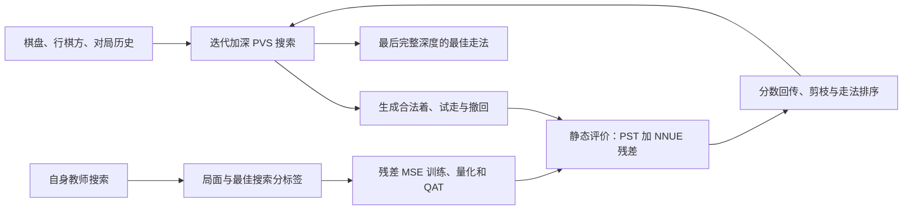

# 中国象棋 AI：从自身搜索学习的增量神经评价器

[English](README.md) · [在线对弈](http://164.152.167.211:8100/) · [NNUE 计算与训练细节](trainnnue/README_zh.md) · [评测报告](docs/nnue_g006_20261106/REPORT_zh.md)

本项目实现一套在普通 CPU 上运行的中国象棋引擎。搜索负责比较后续走法；评价器负责快速判断搜索到的局面。评价器以子力与位置表（PST）为基线，叠加一个从本项目自身搜索中学到的神经网络修正。训练数据、评分标签和教师均来自项目自己的引擎。

当前在线模型为 **g006：H128、左右将位共享训练、int8 特征权重／int16 累加器、E20 QAT**。它在1200万局面上训练，每步约150ms实际搜索用时下，对巫师象眼3.1和天启1.1.8分别取得83.07%和76.56%得分率；已有旋风2007C对局为57.03%。三项固定历史锚点共同拟合约2601参考Elo，具体条件与不确定性见下文。

## 1. 一手棋怎样产生

引擎输入棋盘、行棋方和当前对局历史，输出一个合法走法。它逐层加深搜索：在每个候选走法后模拟对方的应对，再比较回传的分数。内部以红方为正，因此红方节点取最大值、黑方节点取最小值。搜索停止时返回最后一个完整深度的最佳走法。

搜索树会反复访问只相差一次移动的局面。完整重算所有棋子的评价会消耗本可用于加深搜索的时间，所以引擎同时增量维护棋盘派生状态、PST 和神经网络第一层。神经评价只处理本步改变的特征，再计算激活和一个线性输出头。



两条流程的连接点是评价器：训练把自身浅层搜索的判断压缩进网络；实战搜索再用这个廉价静态分数探索更深的后续。外部引擎只用来检验最终棋力。

## 2. 一个局面怎样变成分数

### PST 提供子力与位置基线

PST 总分包含棋子基础价值和所在格的位置奖励。这里兵的基础价值为100，马、炮各450，车1000，士、象各120。红子贡献为正，黑子贡献为负；黑方位置表按对应方向取值。一次走子只需删除原格贡献、加入目标格贡献，并减去被吃子的贡献。

神经网络学习这份基线还缺少的修正。例如子力相同的局面，棋子的配合、威胁和将帅周围结构可能不同；这些关系由网络通过搜索标签拟合。下文为方便说明，统一把分数转为**当前行棋方有利为正**，记 PST 为 $P(B)$。

### 每个在场棋子取一个128维向量

特征包含四部分：本方将帅所在的九宫位置、棋子种类、敌我关系和棋子所在格。完整索引空间为

$$9\times7\times2\times90=11\,340.$$

对红、黑各建立一个视角。红方使用原棋盘，黑方将坐标旋转180度，使本方将帅同样位于底部九宫。每个视角遍历所有在场棋子，包括双方将帅，从**同一张**特征表取向量。将这些向量与偏置相加，得到两个128维累加器：

$$a_v(B)=b+\sum_{f\in F_v(B)}W_f,\qquad v\in\{\text{红},\text{黑}\}.$$

$F_v(B)$ 是视角 $v$ 下激活的特征集合，$W_f\in\mathbb R^{128}$ 是该特征的向量，$b$ 是共享偏置。一个局面每个视角最多激活32行；不会计算11340行的稠密矩阵乘法。

### 激活、阶段输出和残差

令 $s$ 为当前行棋方、$o$ 为对方。两个累加器分别经过截断 ReLU：$C(x)=\min(1,\max(0,x))$，再按“行棋方、对方”的顺序拼接成256维向量：

$$h=[C(a_s);C(a_o)],\qquad z=v_p^\top h+c_p,\qquad r_{\rm float}=Kz.$$

棋盘总棋子数大于20时使用中局头 $p=0$，否则使用残局头 $p=1$；$v_p$、$c_p$ 分别是该头的输出权重和偏置。部署时每次只计算所选的一个256到1线性头。$K=65.38910923790853$ 把训练时归一化的输出 $z$ 换回分数单位。

量化后的推理残差限制在±300，再加回 PST：

$$V(B)=\operatorname{clip}\left(P(B)+r(B),-19999,19999\right).$$

这个分数进入搜索比较。例如在一个**计算示例**中，PST 为80、网络修正为45，则总分为125。网络输出是局面分修正，不经过 sigmoid，也没有概率输出层。

### 左右将位怎样共享

将帅在九宫左列和右列时，两种表示可以通过同时镜像所有棋子位置对应起来。记 $t$ 为棋子类型、$u$ 为敌我关系、$(r,c)$ 为棋子坐标，列号为0至8。训练把三对左右将位的对应向量设为同一参数：

$$W_{\text{右将位},t,u,r,c}=W_{\text{左将位},t,u,r,8-c}.$$

中线三个将位桶保留左右位置的独立参数，因此共有 $6\times14\times90=7560$ 个独立128维向量。训练结束后按映射复制展开成11340行；实战仍用原特征索引，省去额外映射。它约束的是训练参数，运行棋盘不会因此被翻转。

## 3. 怎样让评价足够便宜

### 增量计算与惰性帧

普通走子没有改变某个视角的将位桶时，该视角的新累加器为

$$a'=a-W_{\rm 原格}+W_{\rm 新格}-W_{\rm 被吃子}.$$

没有吃子便省去最后一项。一次更新的工作量随向量宽度128增长，而不是随整盘棋子数增长。激活和输出头仍需计算；降低特征精度主要减少特征读取与更新成本，并没有免除输出计算。

实际搜索还会剪掉许多无需评价的节点。为避免白算，`make_move` 只把走法、动子和被吃子记入当前节点的惰性帧；第一次需要静态评价时，才从最近已计算祖先补齐向量更新。直接父节点已计算时，将“复制父累加器、减旧行、加新行、减被吃行”融合成一次向量循环。撤回时恢复棋盘并退回父帧，直接使用父帧已有状态。

本视角将帅移动会改变所有棋子的特征索引，需要重建该视角。引擎为每个视角的九个将位各保存一份90格棋盘快照及累加器；重建时比较快照和当前棋盘，只更新有差异的格。另一视角的将位未变，仍可按普通移动更新。

### 整数推理与 QAT

g006 将特征权重乘 $E=20$ 后舍入成 int8，累加器使用 int16。浮点激活区间 $[0,1]$ 对应整数区间 $[0,20]$；输出参数使用倍率 $O=128$，并吸收 $K$，最终整数点积除以 $EO=2560$ 恢复残差分数。

E决定量化格点间隔，也影响整数范围。先在浮点最佳检查点上寻找满足权重和累加器安全界的最大整数E，再固定E做量化感知训练（QAT）。QAT前向执行部署所用的舍入、整数缩放和截断，反向用直通梯度更新浮点参数，使优化过程能看到量化造成的误差。

累加器在激活之前就必须安全。记 $W_q$、$b_q$ 为量化特征权重和偏置，$j$ 为累加器维度，加载模型时逐维验证

$$|b_{q,j}|+64\max_f|W_{q,fj}|\le32767.$$

64覆盖将位缓存更新中可能混合两个各不超过32子的局面贡献。g006的最大该边界为8007。输出层以int16激活和int16权重做乘积，使用经边界检查的int32 SIMD部分和，最后以int64加偏置。完整整数公式见[NNUE专题](trainnnue/README_zh.md)。

## 4. 训练数据和评分标签怎样产生

### 用不同走法探索，用最佳搜索分监督

每盘前6个半回合均匀随机选合法着，这段开局不入训练样本；随后按50%、30%、20%选择同深度搜索排名第1、2、3的根走法。只有两着时按5:3归一为62.5%和37.5%；只有一着时直接选择。每盘最多120个半回合，开局后每2个半回合采一个局面，并轮换采样相位及执色。

程序先抽取名次，再只求所需的排名。抽到第一名时直接用单PV最佳着；抽到第二名时排除第一根着再搜索；第三名再排除前两着。这里使用完整窗口搜索取得对应评分，不把零窗口搜索的界当成准确名次，也不按评分差过滤探索走法。

**落子选择和监督标签承担不同作用。** 落子可以选第二或第三名，用来访问不同后续；当前局面的标签始终取探索前保存的教师单PV最佳分。教师在双方回合都统一评分，对手模型只影响访问哪些局面。

### 从纯 PST 建立教师链

第一代由PST对PST产生200万有效局面，PST走子和评分深度均为D4。后续使用已晋级的最优网络作为教师，与PST及每个已晋级网络分别产生新的200万有效局面。NNUE走子、标签搜索使用D3；作为对手的PST仍以D4走子。

g006由g005统一评分，对手为PST和g001至g005，共六组、1200万有效局面。数据按棋盘与行棋方去重，剔除被将军局面与杀棋／饱和评分，再按整盘棋划分，防止同盘相邻局面跨训练和验证集。每来源及行棋方保留配额，合并后全局打散：

| 划分 | 局面数 | 用途 |
|---|---:|---|
| 训练98% | 11,760,000 | 更新网络参数 |
| 验证1% | 120,000 | 选检查点、早停 |
| 留出1% | 120,000 | 本轮保留，未用于训练、选E或重新标定K |

教师搜索保留实际对局的根前历史，网络输入只有棋盘和行棋方。因此标签可能包含网络无法区分的路径信息。当前数据处理会消解或丢弃重复输入的冲突分；它改善数据一致性，但没有给网络增加历史特征。具体规则见专题。

### 只拟合搜索残差

将教师最佳搜索分 $S_i$ 和PST分 $P_i$ 同时转为行棋方视角，构造

$$d_i=\operatorname{clip}(S_i-P_i,-250,250),\qquad L=\frac1N\sum_i\left(\frac{r_i-d_i}{K}\right)^2.$$

$N$ 为批内局面数，$r_i$ 为网络预测残差。例如搜索给140、PST给80，则残差标签为60。这里的±250限制训练目标；部署的±300限制实际网络修正，两者分别在数据目标和推理处生效。训练只用这一项MSE，最终胜负不参与标签或损失。

每代从随机参数开始训练。共享特征初始化为小随机数，输出头初始化为零，因而初始网络修正为零。先做浮点训练，选择验证MSE最好的检查点，再选E并做固定E的QAT。g006使用GTX1650Ti、AdamW、有效batch8192；浮点初始学习率0.003，QAT为0.0003。每轮重新打散样本，并以50%概率做水平镜像增强。[完整超参数](trainnnue/README_zh.md)

```text
教师 = PST；对手集合 = {PST}
重复：
    对每个对手，换色对弈并重新生成200万有效局面
    用同一个教师的最佳搜索分标注所有来源
    整盘划分、平衡、打散；随机初始化H128
    浮点MSE训练 → 选择安全E → 固定E做QAT → 校验整数输出
    对每个已有对手进行等实际耗时换色赛
    全部点得分率 > 50%：候选晋级为教师，加入对手集合
    否则：完成本轮全部预定对手后停止，保留已晋级模型
```

验证loss用于选择拟合检查点，晋级由实际对局决定。上述规则选择出的当前部署模型为g006。

## 5. 搜索怎样利用这个评价器

迭代加深从浅到深建立走法顺序。PVS先完整搜索最有希望的走法，随后用窄窗口检查其他走法能否改善当前结果，需要时再完整重搜。置换表按局面哈希保存搜索深度、分数的精确值或上下界及最佳走法；只有深度和边界条件满足时才复用分数。

深度耗尽后，静态搜索继续处理吃子等战术交换，减少恰好截在交换中间的评价波动；被将军时须考虑合法解将。实战还使用空步、futility和晚着缩减等选择性搜索，集中计算有希望的分支。训练标签搜索关闭TT分数截断及这些激进选择性剪枝，保留Alpha-Beta/PVS、将军延伸和静态搜索，使监督目标来自固定深度的较完整搜索。

每次试走都更新规则所需的对局路径；搜索中识别完整循环后，按腾讯循环规则实现给出分数。计时搜索在节点中检查期限，并在完整一层结束后决定是否继续；已有实现超过名义时间的0.16倍且深度至少4时就会停止启动新层。这使名义预算与实际平均搜索用时不同，评测必须先校准实际用时。

## 6. 当前模型测得怎样

每项正式赛使用96个独立开局，逐一换色，共192局。得分率为 $(胜+0.5\times和)/总局数$，纯胜率为 $胜/总局数$。置信区间按开局对bootstrap重抽，保留同开局两种执色之间的关联。

| 对手 | 胜／和／负 | 纯胜率 | 得分率（95%区间） | 实际ms／步：本引擎／对手 |
|---|---:|---:|---:|---:|
| 本项目PST | 163／22／7 | 84.90% | 90.63%（87.50%–93.49%） | 149.359／150.835 |
| 巫师象眼3.1 | 142／35／15 | 73.96% | 83.07%（78.91%–87.24%） | 149.089／148.672 |
| 天启V1.1.8 | 126／42／24 | 65.63% | 76.56%（71.61%–81.51%） | 150.358／152.969 |
| 旋风2007C | 78／63／51 | 40.63% | 57.03%（52.08%–61.98%） | 144.366／142.902 |

象眼和天启新赛使用生产构建，先用独立开局校准，再以48对开局确认计时，冻结预算后正式比赛。双方各自均值须在150ms±5%内，双方用时比偏差不超过5%。内部对照使用实验构建及同样两项计时门槛；旋风观察也使用该实验构建，沿用仅检查双方时间比的门槛。各项使用同一g006模型，表中保留实际用时，详细身份见[评测报告](docs/nnue_g006_20261106/REPORT_zh.md)。

按照[2026-10-09公开引擎榜](https://bbs.pikafish.org/forum.php?mod=viewthread&tid=179&extra=page%3D1)的象眼2130.2、天启2430和旋风2600锚点，逐项用 $R_{对手}+400\log_{10}(S/(1-S))$ 换算为2407、2636和2649。固定三锚共同拟合为 **2601参考Elo，95%区间2574–2629**。各对手换算差异较大，这个共同分数表示本次短时限比赛在所引历史榜上的坐标。该榜将旋风2600对应到2006—2007年职业顶尖、特级大师的人机比赛参照；原榜四核长时限与本次单核约150ms条件不同。

g006浮点最佳验证MSE为0.491871，直接量化后为0.497580，QAT后为0.488677。三者使用相同残差目标和K归一化；QAT减小了部署计算下的拟合误差。实战表测量的是整套当前系统，单项设计的棋力收益需要各自对照才能分离。

## 7. 使用与检查材料

通过[在线对弈](http://164.152.167.211:8100/)体验当前模型。浏览器和服务器检查合法走法，后端通过引擎协议调用搜索，支持红黑执色与撤回重走。

- [NNUE专题](trainnnue/README_zh.md)：精确索引、整数公式、缓存更新与训练参数。
- [当前评测报告](docs/nnue_g006_20261106/REPORT_zh.md)：当前模型的全部内部对照、公开引擎结果与Elo算法。
- [机器配方](docs/nnue_g006_20261106/recipe.json)：配置、模型身份与来源记录。
- [紧凑对局记录](docs/nnue_g006_20261106/matches.compact.json)：开局、执色、结果和实际搜索统计。

本次公开材料包含当前方法与评测证据；g006完整训练数据、检查点和冻结训练实现仍保留在本地。在线部署的模型与引擎身份记录在配方中，仓库其他运行入口不能据此视为同一g006成品的完整重训包。
