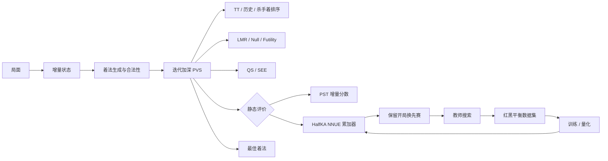
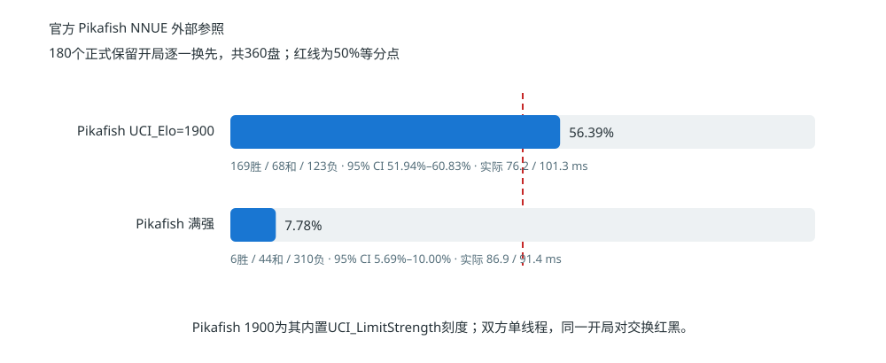
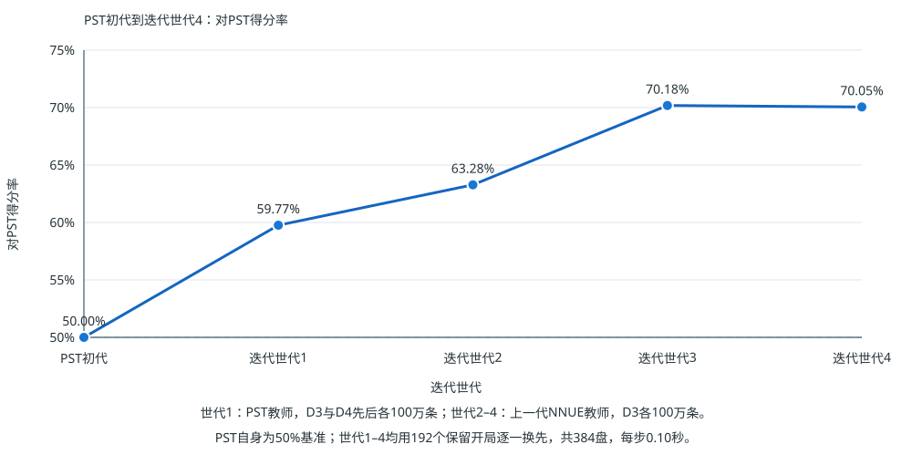
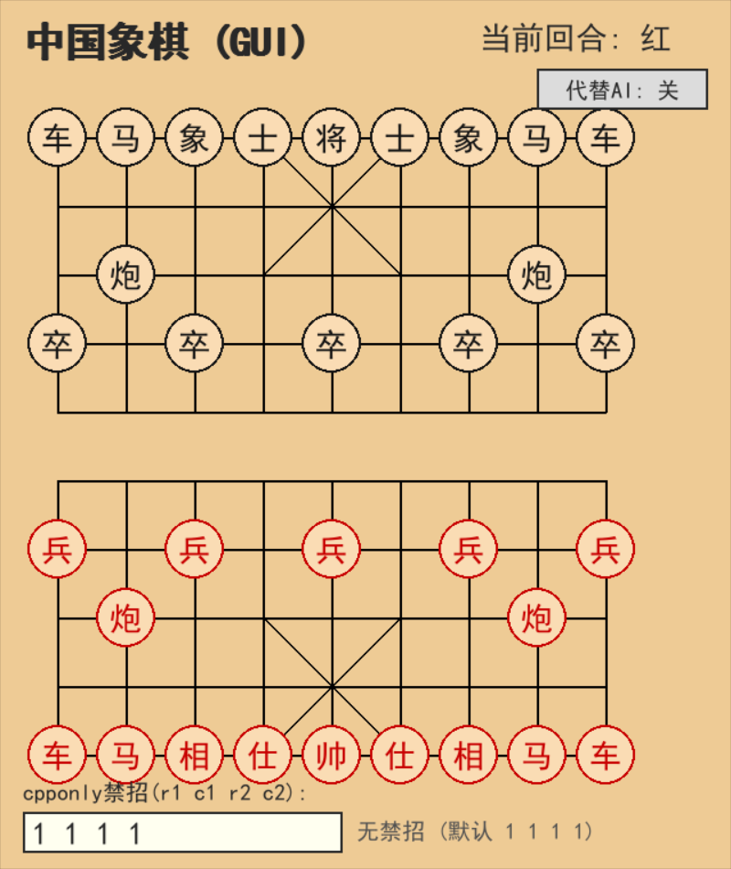
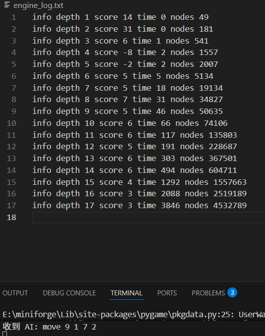

# 中国象棋 AI：增量搜索与量化 NNUE 技术报告

[English](README.md) · [简体中文](README_zh.md)

[在线对弈](http://164.152.167.211:8100/) · [交互式教程](slides-formal-web-lite_zh/index.html) · [运行说明](docs/RUNNING_zh.md) · [实验设计](docs/EXPERIMENTS_zh.md) · [NNUE 专题](trainnnue/README_zh.md)

## 摘要

本项目从零实现普通 CPU 上的中国象棋引擎，组合可逆增量状态、PVS 搜索与量化 HalfKA NNUE。

**2026-11-06 更新：当前线上为 g006 H128，真实 int8 特征权重／int16 累加器，E20 QAT。** 它来自项目自己的纯 PST 重启链；全链完成 28 项历史对局、5376 局，g006 晋级，g007 未通过两项历史点得分率门槛后停止。

| 对手 | 胜／和／负 | 得分率（95%区间） | 实际ms（本引擎／对手） | 参考Elo（95%区间） |
|---|---:|---:|---:|---:|
| 巫师象眼3.1（新赛） | 142 / 35 / 15 | 83.07% (78.91%–87.24%) | 149.089 / 148.672 | 2407 (2359–2464) |
| 天启V1.1.8（新赛） | 126 / 42 / 24 | 76.56% (71.61%–81.51%) | 150.358 / 152.969 | 2636 (2591–2688) |
| 旋风2007C（复用观察） | 78 / 63 / 51 | 57.03% (52.08%–61.98%) | 144.366 / 142.902 | 2649 (2614–2685) |

固定三锚共同拟合为 **2601参考Elo**（开局对bootstrap 95%区间2574–2629）。点估计略高于2600，区间跨2600；各对手单独换算约2407至2649。因此本次结论为引用历史引擎榜上的约2600坐标。该榜的旋风2600锚点参照2006—2007年职业顶尖、特级大师的人机比赛水平。

两项新赛先通过独立48对开局的计时确认，再进行96对正式赛；双方各自实际均值须在150ms±5%内，耗时比偏差不超过5%。名义预算仅依据计时选择，并在正式赛前冻结。旋风复用已有g006观察，按原有仅相对耗时门槛验收。新赛使用生产引擎`ad9a1567…99d5db`，旋风使用实验引擎`e6f367…`；模型相同，引擎实现不同，不能写成一次新跑的三对手生产引擎统一赛。完整身份、纯胜率和区间保存在紧凑JSON与配方中。

[当前训练与评测报告](docs/nnue_g006_20261106/REPORT_zh.md) · [冻结配方](docs/nnue_g006_20261106/recipe.json) · [逐对局摘要](docs/nnue_g006_20261106/matches.compact.json)。

模型 SHA-256：`746e930533cddf7907c85545659605b7477bf32bdb0335a6ca0b3b743455af5e`。[在线试玩](http://164.152.167.211:8100/)。

## 1. 问题定义与技术贡献

项目围绕三个相互制约的问题展开：

1. 如何让棋盘及其派生状态在数百万次试走中精确、低成本地往返？
2. 如何利用走法排序、缓存和选择性搜索，在固定时间内完成更深的有效搜索？
3. 如何设计一个表达能力足够、推理成本足够低的神经评价器，使等时棋力获得提升？

对应的核心实现如下。

| 模块 | 实现 | 工程作用 |
|---|---|---|
| 增量状态 | 棋盘、棋子表、将帅位置、占位、PST、Hash、NNUE 累加器同步更新 | 降低搜索树内高频走子与评价成本 |
| 搜索 | 迭代加深、PVS、TT、QS/SEE、走法排序、LMR、Null Move、Futility | 在固定思考时间内完成更深的有效搜索 |
| 评价 | PST 基线与量化 HalfKA NNUE 双路径 | 直接测量神经评价相对手工评价的棋力增益 |
| 实验 | 平衡数据集、教师可配置、训练早停、配对统计、图表自动生成 | 保存从数据、模型到对局结论的完整链路 |
| 工程 | stdio 引擎协议、pygame、FastAPI/WebSocket、Pikafish 桥接 | 同一搜索核心服务本地交互、网页与批量实验 |

## 2. 系统设计



主搜索器保留 PST 与 NNUE 两条评价路径。教师搜索生成局面标签，训练结果量化后进入 C++ 推理器，经过等时比赛筛选的模型再用于下一轮数据生成。搜索、训练和对局因此形成可重复的闭环。

## 3. 增量状态与规则实现

局面由 `board[10][9] + turn` 表示，大写棋子属于红方，小写棋子属于黑方。七类棋子分别生成伪合法着，再通过试走、查将和撤销得到合法着法。

一次走子同时维护：

- 棋盘与双方棋子列表；
- 将帅坐标、行列占位和攻击查询所需状态；
- 材料与 PST 增量分数；
- Zobrist hash、重复局面与搜索路径；
- NNUE 双视角第一层累加器。

吃子时使用交换补洞保持棋子表连续。撤销操作恢复棋盘、索引、分数、哈希和累加器的原值，使搜索树中的兄弟分支共享同一套状态对象。浏览器与服务端共同校验人类着法，规则检查保持一致。

## 4. 静态评价

### 4.1 材料价值与 PST

PST 路线把每枚棋子的基础价值与所在格位置分相加，红方记正、黑方记负。`current_score` 在走子时完成增量更新：移除起点贡献、加入终点贡献，吃子时再移除目标棋子贡献，因此 `evaluate()` 可以直接返回缓存分数。

PST 为搜索提供常数时间评价，也构成神经评价器的残差基线。两条评价路线使用相同的局面、走法与搜索代码，直接比较集中在评价模块本身。

### 4.2 NNUE 网络结构

```text
HalfKA（7560 行独立权重，展开为 11340 行）→ H128 → CReLU → 阶段输出头 → PST 残差
```

特征按 9 个己方将位、14 个敌我／棋子种类通道、90 个棋子位置索引。三对左右将位连同棋子位置镜像共享，中线三个桶独立。红黑定向双视角共用特征表；导出复制展开，推理不增加镜像查表。线上模型采用 int8 特征权重、int16 累加器及 E20 QAT。详细表示及整数校验见[当前报告](docs/nnue_g006_20261106/REPORT_zh.md)。

### 4.3 增量累加器

第一层计算结果缓存在引擎对象的双视角累加器中。普通走子只减去源格特征、加入目标格特征，并在吃子时减去被吃棋子特征；将帅移动触发对应锚点视角重建。`undo_move()` 执行严格逆更新，`null move` 只改变待走方。

该设计把高维稀疏层的计算从“每次评价扫描全部棋子”改为“每次走子更新发生变化的特征”，使 NNUE 能够进入静态搜索的高频评价路径。

### 4.4 训练与教师迭代

纯 PST 重启链按 50%／30%／20% 选择同深度前三条根走法，标签始终取独立单 PV 最佳分。首代 PST 行棋、评分 D4，后续 NNUE 使用 D3；每个历史来源每代重新贡献 200 万有效局面，七代依次为 200 万至 1400 万。每代随机初始化 H128，只用归一化截断搜索残差 MSE，随后固定安全整数倍率做 QAT；按整盘棋划分 98%／1%／1%。外部引擎只评测，不参与训练。保存标签 `S_i` 为该样本含实际根前历史的独立单 PV 最佳分，网络输入 `B_i` 为棋盘与行棋方。损失公式与完整配方见[当前报告](docs/nnue_g006_20261106/REPORT_zh.md)。

## 5. 完整搜索

搜索器从 Minimax 递归出发：红方选择最高分支，黑方选择最低分支，叶节点调用静态评价。工程实现以限时迭代加深为外层框架，从浅到深重复搜索，并始终保存最近一次完整深度的最佳着与分数。

| 机制 | 保存或计算的内容 | 搜索收益 |
|---|---|---|
| Alpha-Beta / PVS | 当前分数窗口 | 截断无法改变上层选择的分支 |
| Aspiration Window | 围绕上一深度分数的窄窗口 | 提高常见稳定局面的截断效率 |
| Zobrist Hash / TT | 深度、分数、边界类型、最佳着 | 复用置换局面并提供首选着法 |
| Quiescence Search | 吃子、将军等强制变化 | 把叶节点推进到更稳定的局面 |
| SEE | 目标格连续交换的静态收益 | 改善吃子排序与静态搜索效率 |

置换表中的分数已经包含对应叶节点的 PST 或 NNUE 评价；命中时按保存深度和边界类型参与当前搜索。迭代加深产生的主变化与 TT move 又为下一深度提供排序信息。

## 6. 选择性搜索与时间管理

完整宽度随深度指数增长，选择性搜索依据局面类型和走法次序分配节点预算。

| 类别 | 方法 | 决策依据 |
|---|---|---|
| 走法排序 | TT Move、MVV-LVA、Killer、Counter Move、History | 历史搜索与战术价值 |
| 深度缩减 | LMR、LMP | 排名靠后、深度和局面安静程度 |
| 前向剪枝 | Null Move、Futility、Reverse Futility、Razoring | 静态分数与 Alpha-Beta 窗口距离 |
| 恢复机制 | 窄窗口失败后重搜、关键着完整深度 | 搜索结果越过当前界限 |

时间管理在节点循环中检查截止时间，迭代边界负责提交完整结果。训练教师使用相同规则、评价和静态搜索，同时关闭依赖经验假设的前向剪枝，为固定深度监督标签提供稳定计算路径。

## 7. 实验设计

本轮每个历史对手采用 96 个开局逐一换色，共 192 局。独立校准后冻结名义预算，正式赛双方各自实际平均用时须在 150 ms±5% 内，同时双方耗时比偏差不超过 5%。每项点得分率 `(胜＋半和)／总局数` 均严格超过 50% 才晋级；未过也完成本代其余预定项后停止。纯胜率、开局对 bootstrap 95% 区间及实测耗时分别报告，见[当前报告](docs/nnue_g006_20261106/REPORT_zh.md)。

下方 360／384 局旧协议与图片属于历史 Iter2 实验。

## 8. 历史实验结果（Iter2 及更早）

### 8.1 公开引擎实战坐标



| 公开引擎 | 自研胜/和/负（得分率） | 换算 Elo |
|---|---:|---:|
| [巫师象眼 3.1](trainnnue/iter2_vs_eleeye31_180pairs.json) | 290/31/39（84.86%） | ≈2430 |
| [象棋天启 V1.1.8](trainnnue/iter2_vs_tianqi118_180pairs.compact.json) | 109/79/172（41.25%） | ≈2369 |
| [象棋旋风 2007C](trainnnue/iter2_vs_cyclone2007c_180pairs.compact.json) | 60/95/205（29.86%） | ≈2452 |
| [Pikafish 2026-01-31 · UCI_Elo=1900](trainnnue/iter2_vs_pikafish_elo1900_180pairs.json) | 169/68/123（56.39%） | ≈1945（限强刻度） |
| [Pikafish 2026-01-31 · 满强](trainnnue/iter2_vs_pikafish_official_180pairs.json) | 6/44/310（7.78%） | ≈3573（跨代边界） |

换算公式为 `对手参考 Elo + 400 × log10(得分率 / (1 − 得分率))`。参考榜给出的象眼、天启、旋风和满强 Pikafish 分别为 2130.4、2430、2600 和 4002.7；Pikafish 1900 是引擎内置限强刻度。三个相邻历史引擎给出 **2369–2452 Elo**，该历史模型的中心落在**约 2400 Elo**，以中国象棋协会公布的 [2021 年末棋手等级分](https://www.sport.gov.cn/qpzx/n5384/c23886046/content.html)中约 2400 的大师记录作为历史数值参照；Pikafish 两行展示现代引擎的限强坐标与满强上界。

全部比赛使用 180 个开局逐一换先，共 360 盘，并固定单核。实际平均用时（自研 / 对手）为：象眼 104.0 / 119.4 ms，天启 155.0 / 159.6 ms，旋风 112.4 / 89.9 ms，Pikafish 1900 档 76.2 / 101.3 ms，满强 86.9 / 91.4 ms。旋风一组中自研实际用时多约 25%，表中按原始成绩保留该条件。

### 8.2 NNUE 代际结果



| 迭代世代 | 教师与数据 | 对 PST 得分率 | 胜 / 和 / 负 |
|---:|---|---:|---:|
| PST 初代 | PST 基线 | 50.00% | 基准 |
| 1 | PST D3、D4 各 100 万条 | 59.77% | 172 / 115 / 97 |
| 2 | 上一代 NNUE + D3，100 万条 | 63.28% | 188 / 110 / 86 |
| **3** | **上一代 NNUE + D3，100 万条** | **70.18%** | **218 / 103 / 63** |
| 4 | 上一代 NNUE + D3，100 万条 | 70.05% | 224 / 90 / 70 |

第三世代取得最高实测得分率，配对 95% CI 为 **66.80%–73.44%**，该历史实验当时的网页与本地 NNUE 入口均使用该模型。第四世代与第三世代进入同一性能平台，代际实验由此完成。

### 8.3 网络宽度与搜索成本

在相同条件下，D4-H16 对 D4-H8 得分率为 **54.17%**，平均完成深度为 **9.18 vs 9.24**。H16 的额外评价成本保持在很小的深度差内，同时获得直接对局优势，因此成为该历史实验选择的宽度。

完整离线指标、训练曲线、瑞士轮排名、逐代对局和 checkpoint 信息集中在 [trainnnue/README.md](trainnnue/README_zh.md) 与自动生成的 [RESULTS.generated.md](trainnnue/RESULTS.generated_zh.md)。

## 9. 可复现性

### 9.1 运行引擎

完整环境、模型版本、编译参数与环境变量见 [docs/RUNNING.md](docs/RUNNING_zh.md)。网页端最短运行路径：

```powershell
python -m pip install -r requirements.txt
python webapp.py
# http://localhost:8000
```

桌面端运行：

```powershell
python gui.py
```

### 9.2 实验入口

| 任务 | 命令 / 脚本 | 产物 |
|---|---|---|
| 引擎 A/B 回归 | `python ab_selfplay.py baseline.exe candidate.exe` | 分时间档日志与汇总 JSON |
| 官方 Pikafish 外部赛 | `trainnnue/run_external_match.ps1` | 换先逐盘结果、实际耗时与配对 CI |
| 巫师象眼 3.1 外部赛 | `trainnnue/run_eleeye_match.ps1` | UCCI 桥接、单核换先逐盘结果 |
| 象棋旋风 2007C 外部赛 | `trainnnue/run_cyclone_match.ps1` | Cyclone UCI 桥接、合法性审计与逐盘结果 |
| 象棋天启 V1.1.8 外部赛 | `trainnnue/run_tianqi_match.ps1` | UCI 桥接、合法性审计与逐盘结果 |
| NNUE 换先赛 | `python trainnnue/engine_match.py ...` | 逐盘 JSON、得分率、配对 CI |
| 多模型瑞士轮 | `python trainnnue/swiss_tournament.py` | 排名与交手记录 |
| 教师迭代 | `trainnnue/run_teacher_iteration.ps1` | 数据、模型、校验与对局产物 |
| 重建结果 | `python trainnnue/report_results.py` | Markdown 表格与 SVG 曲线 |
| 自动测试 | `python -m pytest tests -q` | 规则与 WebSocket 测试结果 |

保存的 JSON 结果可以一键生成 [实验汇总](trainnnue/RESULTS.generated_zh.md)、[外部基准图](trainnnue/external_benchmark_zh.svg)、[训练曲线](trainnnue/training_curve_zh.svg)和[代际棋力曲线](trainnnue/iteration_vs_pst_zh.svg)，使数字、表格与图片保持同源。具体 A/B 协议见 [docs/EXPERIMENTS.md](docs/EXPERIMENTS_zh.md) 和 [AB_SELFPLAY.md](AB_SELFPLAY_zh.md)。

## 10. 工程接口

搜索核心通过简洁的 stdio 协议与外围程序通信，同一引擎可用于本地界面、网页会话和批量实验。网页端通过 FastAPI/WebSocket 管理独立对局，可切换自研 NNUE、自研 PST 与 Pikafish PST；`pikafish_bridge.py` 负责 UCI 协议转换；[`deploy/deploy.ps1`](deploy/deploy.ps1) 负责远程同步、编译、模型上传、服务重启和 HTTP 检查。

| pygame 棋盘 | 搜索深度、分数、节点与主变化日志 |
|:---:|:---:|
|  |  |

## 11. 仓库结构

| 路径 | 内容 |
|---|---|
| [`xiangqi_ai.cpp`](xiangqi_ai.cpp) | PST 评价、增量状态与主搜索器 |
| [`trainnnue/`](trainnnue/) | 数据生成、训练、量化、校验、比赛与模型 |
| [`common.py`](common.py) | 共享规则、云开局库与引擎进程通信 |
| [`gui.py`](gui.py) | pygame 交互界面 |
| [`webapp.py`](webapp.py), [`static/`](static/) | FastAPI/WebSocket 交互接口 |
| [`tests/`](tests/) | 规则、云库、会话与网页测试 |
| [`deploy/`](deploy/) | Linux 服务配置与部署脚本 |
| [`slides-formal-web-lite/`](slides-formal-web-lite_zh/) | 从规则、评价到搜索和 NNUE 的交互式教程 |
